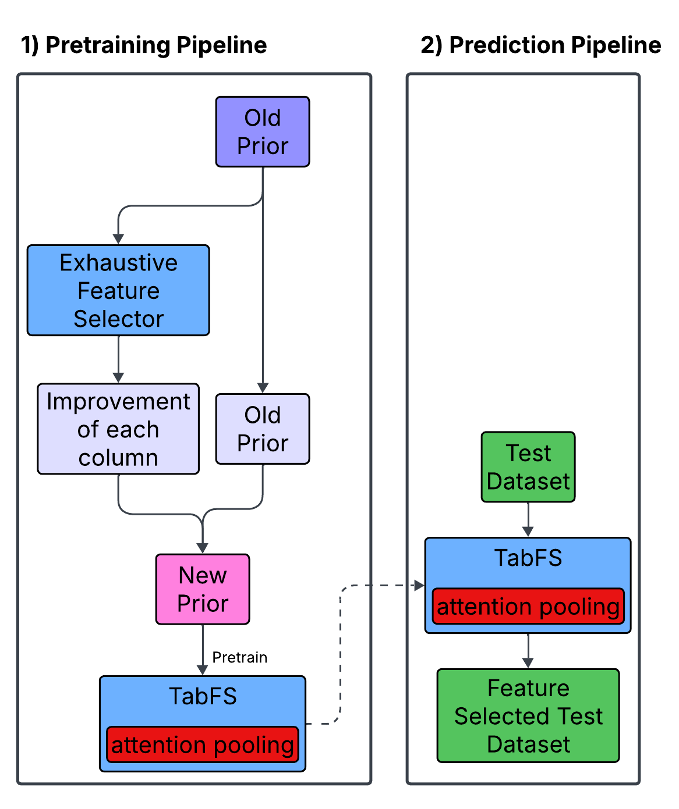

# Prior Test for Feature Selection with a Tabular Foundation Model

This project is the code basis to study the design of an prior for feature selection based on metalearning and the work of nanoPFN.

## Pretraining
To pretrain nanoPFN, you need to download the prior data dump at first:

`mkdir -p data/prior`

`curl -L -o data/prior/300k_150x5_2.h5 "https://ndownloader.figshare.com/files/58932628?private_link=63fc1ada93e42e388e63"`

Secondly, `run_pretraining_pipeline.py` can be executed.

## Inference
In order to get the predictions, execute `run_prediction_pipeline.py`.

## Concept
We design a new prior for nanoTabPFN consisting of the old prior + information about the model performance of leave-one-out feature selection on the old prior
Based on the architecture of nanoTabPFN, we use attention pooling to collapse the rows in the TFM and remove X_test from the architecture

## To Do
- [X] Implement the pretraining pipeline
- [X] Implement the prediction pipeline
- [X] Implement leave-one-out feature selection
- [X] Add checkpoint after pretraining to avoid retraining before prediction
- [ ] Replace dummy evaluate_data function 
- [ ] Read nanoTabPFN paper and understand the architecture
- [ ] Implement the new prior in the architecture
- [ ] Implement the architectural changes to remove X_test from the architecture
- [ ] Implement the architectural changes to add attention pooling to collapse the rows in the TFM