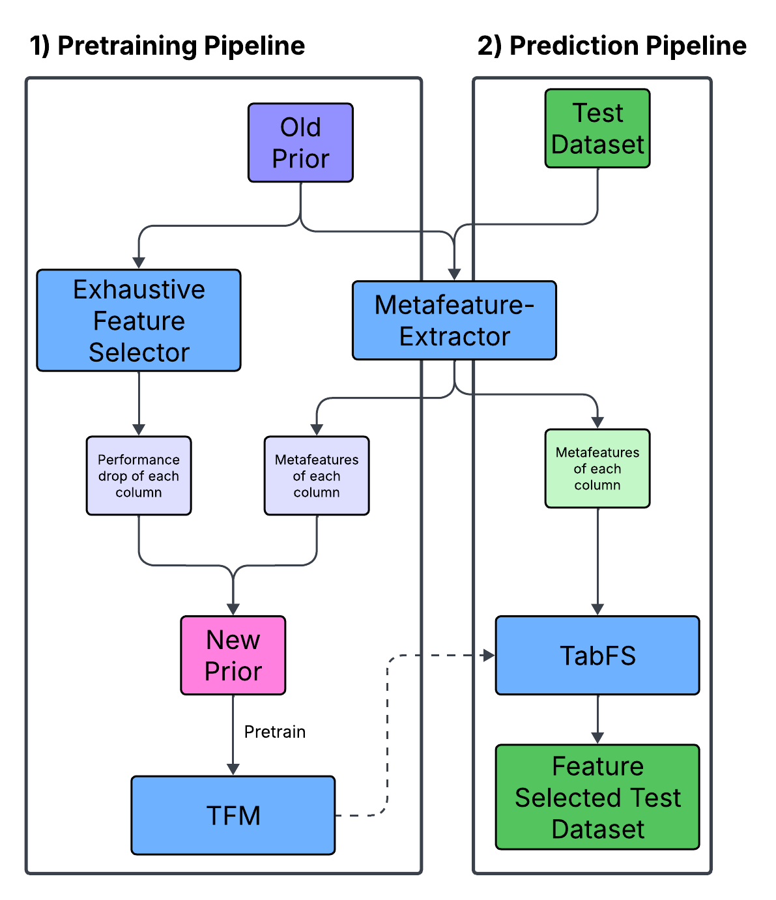

# Meta Prior Test for Feature Selection with an educational Tabular Foundation Model

This project is the code basis to study the design of an prior for feature selection based on metalearning and the work of nanoTabPFN.

## Pretraining
To pretrain nanoPFN, you need to download the prior data dump at first:
mkdir -p data/prior
curl -L -o data/prior/300k_150x5_2.h5 "https://ndownloader.figshare.com/files/58932628?private_link=63fc1ada93e42e388e63"

Secondly, run_pretraining_pipeline.py can be executed.

## Inference
In order to get the predictions, execute run_prediction_pipeline.py.

## Warning
The exhaustive feature selection is only a dummy implementation that returns a random performance.
The results are therefore nonsense.

## Concept

## Conceptual Problems
- Since the Metafeatures extracted from the Test Dataset is always in the same format as the New Prior, ICL is not necessary, we can just learn it with a normal model
- We need y_train for fitting and predicting with TabFS, which does not exist within this pipeline (since we don't have any idea of the performance of the features before inference)
